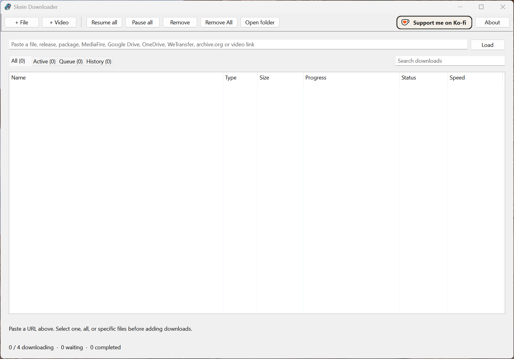
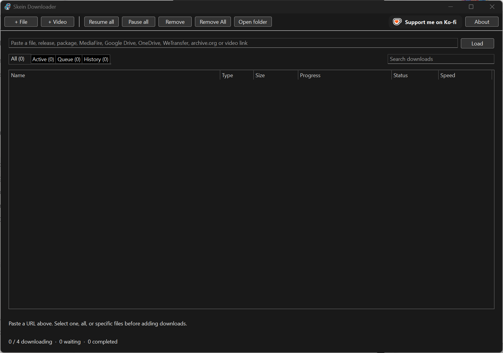
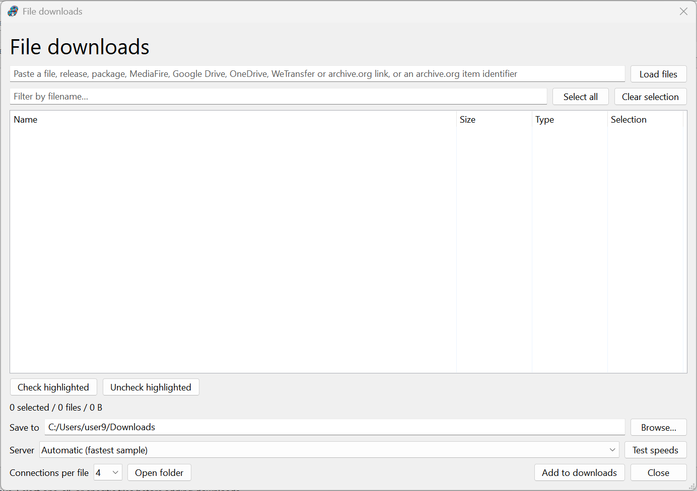
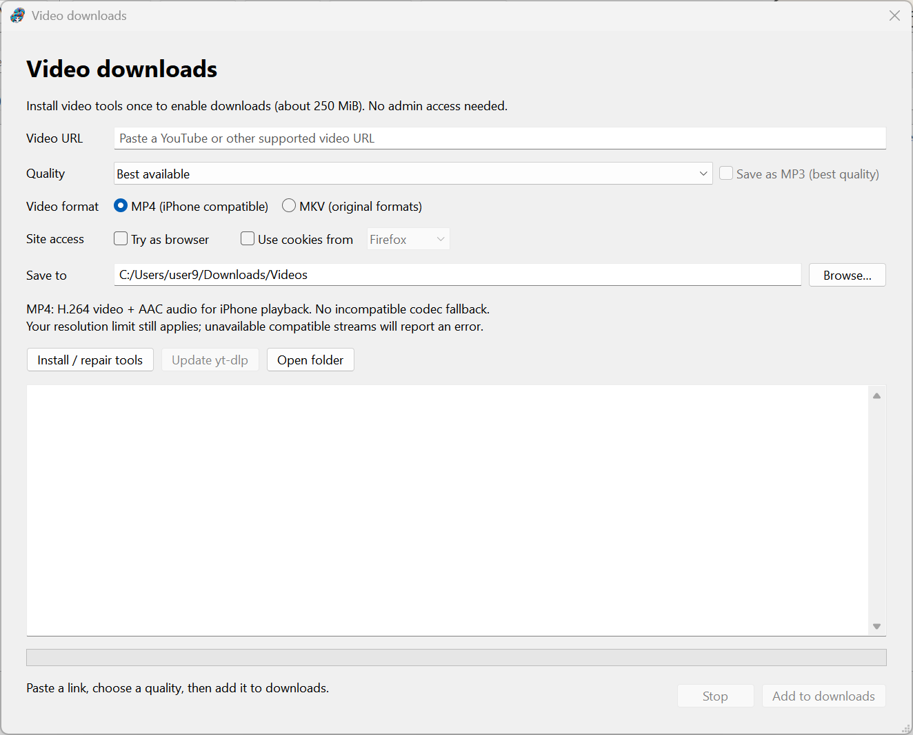
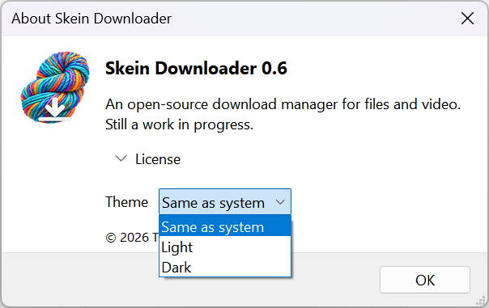

  

# Skein Downloader

**A native download manager for files and video.**

Skein brings multi-connection downloads, pause and resume, a download queue, and
video downloads together in a native Windows and Linux app. Choose a Windows
installer or portable ZIP, a Flatpak with SteamOS support, or a Linux AppImage.

Similar in purpose to Free Download Manager, Skein is an independent, open-source
project. It is not affiliated with or endorsed by the makers of Free Download Manager.

**[Downloads](#downloads) · [Screenshots](#screenshots) · [Quick start](#quick-start) · [Build guide](BUILDING.md)**

> **Work in progress.** Skein is under active development. Expect rough edges,
> missing features, and changes between releases.

## Features

- **Files and video in one place** — direct links, supported file hosts, and video downloads through yt-dlp.
- **Multiple connections** — download a file using multiple connections, with up to four downloads running at once.
- **A manageable queue** — pause and resume, search downloads, and keep saved history.
- **Pick the files you want** — browse Internet Archive collections, GitHub and GitLab releases, and Hugging Face repositories before adding downloads.
- **Native light and dark themes** — follow the system theme or choose your own.
- **Open source** — C++20 and wxWidgets, licensed under GPL-3.0-or-later.

## Screenshots

### Your downloads, in light or dark

<table>
  <tr><th>Light theme</th><th>Dark theme</th></tr>
  <tr>
    <td></td>
    <td></td>
  </tr>
</table>

### Choose files before downloading

Load a supported link, filter the file list, select what you need, and choose the
destination and connections per file.

### Video options in one window

Choose quality, MP4 or MKV, a destination folder, and optional browser-cookie access.
Install or repair the video tools from the same window.

Theme settings

Choose **Same as system**, **Light**, or **Dark** under **About → Theme**.

## Downloads

Find release packages on the [Releases page](https://github.com/tcottrill/skein-downloader/releases).
Skein is packaged in four formats:

| Download | File |
|---|---|
| Windows installer (64-bit) | `SkeinDownloader-<version>-windows-x64-setup.exe` |
| Windows portable (64-bit) | `SkeinDownloader-<version>-windows-x64-portable.zip` |
| Linux Flatpak (SteamOS, any distribution with Flatpak) | `SkeinDownloader-<version>-linux-x86_64.flatpak` |
| Linux AppImage (Ubuntu 22.04 and newer) | `SkeinDownloader-<version>-linux-x86_64.AppImage` |

`SHA256SUMS.txt` lists their checksums. The release also carries the source of the
video tools bundled in the Linux packages (see [Publishing a release](BUILDING.md#publishing-a-release)).

- **Windows installer:** installs for the current user without administrator rights,
  into `%LOCALAPPDATA%\Programs\Skein Downloader`, with a Start menu shortcut, an
  optional desktop shortcut and an entry in Settings > Apps. It needs an internet
  connection: a page lists the video tools it downloads (yt-dlp, Deno and FFmpeg from
  GitHub, about 255 MB, with their sources and licenses), and on Install it downloads
  them, showing each file, and checks each against the SHA-256 GitHub publishes. If
  that fails, nothing is installed. Silent installs (`/VERYSILENT`) download the same
  way. The uninstaller removes the program and the tools; settings and history stay.
  The installer is not code-signed yet, so Windows SmartScreen may warn before it runs.
- **Windows portable:** unzip anywhere and run `skein-downloader.exe`. Install the video
  tools from **Install / repair tools** in the video window on first use.
- **Flatpak:** `flatpak install --user ./SkeinDownloader-<version>-linux-x86_64.flatpak`,
  then `flatpak run io.github.tcottrill.SkeinDownloader//preview`. Use this on SteamOS.
- **AppImage:** `chmod +x SkeinDownloader-<version>-linux-x86_64.AppImage` and run it;
  without FUSE 2 (`libfuse2`) add `--appimage-extract-and-run`.

## Quick start

1. Install or unpack the package for your platform.
2. Paste a link into the main window and click **Load**, or choose **+ File** or **+ Video**.
3. Select your files or video options, choose a destination, and add the download.
4. Manage downloads from the main window with **Pause all**, **Resume all**, and the queue tabs.

- **+ File** and **+ Video** open their windows with the link on the clipboard when it
  is one they handle, sorted as the main window's **Load** sorts it: file hosts and file
  links go to File downloads, other video links to Video downloads. Otherwise the link
  box starts empty; the last link is not remembered. + File only fills in the link;
  click **Load files** to list the files.
- **Theme:** About > Theme chooses Same as system, Light or Dark. On Windows this is
  Windows' own dark mode (title bar, menus, buttons, lists, tabs, scroll bars) and
  applies the next time the program starts; on Linux it applies at once.

`--video` opens the video options. `--data-dir <absolute path>` uses a separate profile.
Only one instance may use a profile; a second launch brings the running window forward.

Settings (`settings.ini`) and history live in:
- Windows: `%LOCALAPPDATA%\SkeinDownloader`
- Linux: `$XDG_DATA_HOME/SkeinDownloader`, or `~/.local/share/SkeinDownloader`
- Flatpak: `~/.var/app/io.github.tcottrill.SkeinDownloader/data/SkeinDownloader`

Each launch writes `skein-downloader.log` in that folder: startup environment, display
backend and theme, window layout, job state changes, download errors and retries, and
GTK/wx warnings. Include it when reporting a problem.

File downloads default to the normal Downloads folder; existing files are never overwritten.

## Video downloads

Video downloads use yt-dlp, FFmpeg/ffprobe and Deno.
- Windows installer: Setup downloads them into `video-tools` next to the program.
- Windows (installer or portable): **Install / repair tools** in the video window runs
  `install-video-tools.ps1` (kept next to the executable), which downloads the official
  releases into `video-tools` and verifies their SHA-256 digests. The same window
  updates yt-dlp.
- Flatpak: yt-dlp and Deno are bundled; FFmpeg comes from the Freedesktop runtime.
- AppImage: yt-dlp, Deno and FFmpeg are bundled.
- Other Linux builds: set `SKEIN_VIDEO_TOOLS` to a folder containing Linux `yt-dlp`,
  `ffmpeg`, `ffprobe` and `deno`, or put them in `../libexec/skein-downloader` next to
  the executable.

Access to browser cookies is opt-in and is never restored across launches.

## Known limits

Native themes differ between Windows and GTK. On Windows a theme change applies after a
restart. The indeterminate ("Working…") progress bar is not animated. Wayland window
activation is subject to the compositor's focus policy. Mixed-DPI monitor changes on
Windows and SteamOS/Batocera devices still need hands-on testing. The Windows installer
is not code-signed.

## Requests and problems

Missing support for a site you want? [File an issue](https://github.com/tcottrill/skein-downloader/issues)
and ask for it. People who support me on [Ko-fi](https://ko-fi.com/timcottrill) get
priority on their requests. When reporting a problem, include `skein-downloader.log`
(see [Quick start](#quick-start) for where it is).

## Building from source

See [BUILDING.md](BUILDING.md) for Windows and Linux builds, packaging, dependencies,
release preparation, and the local showcase page.

## License

Copyright (C) 2026 Tim Cottrill

This program is free software: you can redistribute it and/or modify it under the
terms of the GNU General Public License as published by the Free Software
Foundation, either version 3 of the License, or (at your option) any later version.
It is distributed in the hope that it will be useful, but WITHOUT ANY WARRANTY;
without even the implied warranty of MERCHANTABILITY or FITNESS FOR A PARTICULAR
PURPOSE. See [LICENSE](LICENSE) for the full text.

Third-party components keep their own licenses: wxWidgets (wxWindows Library Licence,
`vendor/wxWidgets/docs/licence.txt`), nlohmann/json (MIT), and the yt-dlp, FFmpeg and
Deno helpers (see `packaging/licenses/`).
